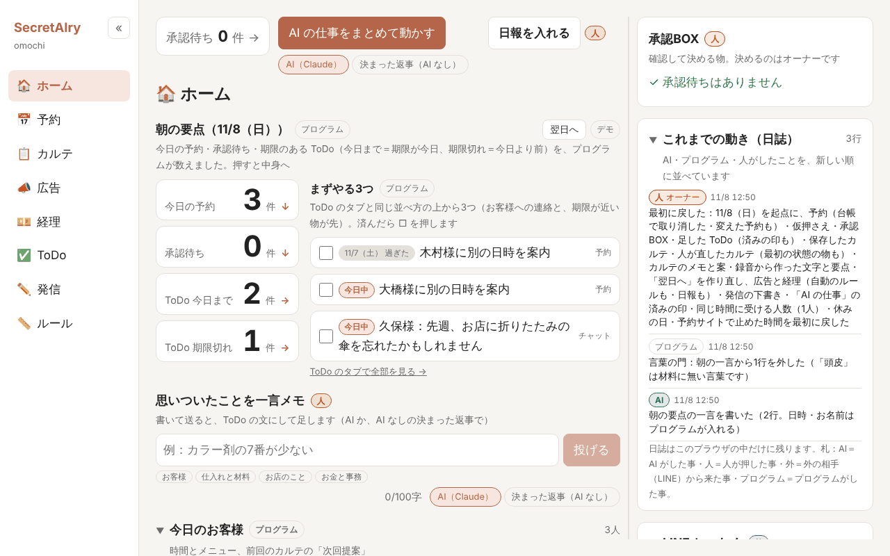

<h1 align="center">SecretAIry</h1>

日本語版: <a href="README.md">README.md</a>

<b>This is an English summary of the main README (Japanese).</b> 
  Full details (how to run it, environment variables, where data is kept, how it is protected, production test results and more) are in the <a href="README.md">Japanese README</a>.

  In a hair salon run by one person, the owner has to do every job alone: the treatments, and also the paperwork such as bookings, client charts (karte), ads and accounting. During a treatment their hands are busy, so the paperwork waits until after business hours, and doing everything alone is hard. 
  SecretAIry is an app in which an AI secretary prepares tentative booking holds, chart drafts, ad review proposals and post drafts; the AI does not confirm anything, and the decision is always a person's button.

  <a href="https://secretairy.vercel.app"><b>Open the live app (https://secretairy.vercel.app)</b></a>
  &nbsp;｜&nbsp;
  <a href="https://youtu.be/Lw1JhyqQ7bQ"><b>Demo video</b></a> 
  Narration is synthesized speech

  <a href="https://youtu.be/Lw1JhyqQ7bQ"> ▶ Demo video (2:58)</a>

  Jump to a scene:
  <a href="https://youtu.be/Lw1JhyqQ7bQ?t=47">Home (0:47)</a>
  ｜
  <a href="https://youtu.be/Lw1JhyqQ7bQ?t=57">Booking (0:57)</a>
  ｜
  <a href="https://youtu.be/Lw1JhyqQ7bQ?t=71">LINE (1:11)</a>
  ｜
  <a href="https://youtu.be/Lw1JhyqQ7bQ?t=77">Client notes (1:17)</a>
  ｜
  <a href="https://youtu.be/Lw1JhyqQ7bQ?t=92">AI jobs (1:32)</a>
  ｜
  <a href="https://youtu.be/Lw1JhyqQ7bQ?t=106">Ads (1:46)</a>
  ｜
  <a href="https://youtu.be/Lw1JhyqQ7bQ?t=122">Accounting (2:02)</a>
  ｜
  <a href="https://youtu.be/Lw1JhyqQ7bQ?t=133">Posts (2:13)</a>
  ｜
  <a href="https://youtu.be/Lw1JhyqQ7bQ?t=143">ToDo (2:23)</a>
  ｜
  <a href="https://youtu.be/Lw1JhyqQ7bQ?t=150">Rules (2:30)</a>
  ｜
  <a href="https://youtu.be/Lw1JhyqQ7bQ?t=163">AI cost (2:43)</a>

  

The app's screens are in Japanese.

## The point in 30 seconds

- **Who has what problem**: The owner of a hair salon run by one person. The owner has to do every job alone: the treatments, and also the paperwork such as bookings, charts, ads and accounting. During a treatment their hands are busy, so the paperwork waits until after business hours. Doing everything alone is hard.
- **What the app does**: The AI secretary prepares tentative holds from the booking chat, chart drafts, ad review proposals and post drafts. Tentative holds and ad proposals line up in the owner's approval box (「承認BOX」), and the owner looks at them and decides.
- **A person always decides**: The AI goes only as far as tentative holds and proposals. Only a person's button confirms anything (the owner's approval, or a client deciding on the booking site themselves), and the app makes no health or medical judgments (the two 🔒 locked rules).
- **Where to try it**: Open the live app at https://secretairy.vercel.app and you can use every tab with no key and no sign-up. The salon in the app (omochi), its clients and its numbers are made up.

### Try it in 5 minutes

1. In the booking chat on the **予約** (Bookings) tab, ask something like 「来週の土曜にカットをお願いします」 ("A cut next Saturday, please") → the AI offers open slots; pick one (for example 「1つ目で」 (the first one)) → the AI places a tentative hold. (If the AI cannot be reached, switch to 「決まった返事（AI なし）」 (Fixed replies (no AI)) and try the same flow with the example sentences on the screen.)
2. In the approval box on the **ホーム** (Home) tab, press 「承認」 (Approve) on that hold → it goes into the ledger as confirmed. The decision was a person's button.
3. On the **広告** (Ads) tab, press 「AI に見直してもらう」 (Ask AI to review) → one proposal to pause or exclude appears in the approval box (the right column of the Ads tab, and Home); an add proposal may come with it → when you press 「承認」 (Approve), on the live app that one change is really sent to a Google Ads test account (no ads are shown and no money moves), and the list read back from it is shown. A review proposal can be made only once every 7 days, so to try again, press 「最初に戻す」 (Reset to the start) on Home.
4. On the **経理** (Accounting) tab, mark statement lines as 「店用」 (Shop) or 「私用」 (Personal) and register them. If the 「テスト用の事業所で試す」 (Try it with the test business) panel is shown, you can really register in a freee test business; if it is not, you can try the same flow with the statement lines inside the app.
5. On the **ルール** (Rules) tab, write a rule in words such as 「カラーの後は15分あける」 ("leave 15 minutes after a color") and the AI fills in the fields for adding it. Adding it is a person's 「足す」 (Add) button. (This field is shown only when the AI can be reached.)

If you get stuck, 「最初に戻す」 (Reset to the start) on Home returns everything in this browser to the starting state.

### Guide by tab

Short notes per screen (what you see, what each button does, which button a person decides with)

- **ホーム** (Home)
  - The morning summary (today's bookings, pending approvals, ToDo, free time) and the top three things to do. The right column has the approval box, the log and 「LINE とつなぐ」 (Connect with LINE).
  - Rows in the approval box are decided with 「承認」 (Approve), 「直す」 (Revise) and 「見送り」 (Skip); the owner's button decides (rows for ad add proposals and undo proposals have only 「承認」 (Approve) and 「見送り」 (Skip)). On a regular ad proposal row, 「チームの会議にかける」 (Take it to the team meeting) lets you read the AI team's views.
  - 「AI の仕事をまとめて動かす」 (Run the AI jobs together) runs, one at a time and only when pressed, a booking request, new statement lines, an ad review, a memo and a booking from the booking site (the AI does not confirm anything; only a booking from the booking site goes in as confirmed, as a booking the client decided).
  - 「翌日へ」 (Next day) moves today forward by one business day (closed days are skipped). 「最初に戻す」 (Reset to the start) resets this browser only when you press 「最初に戻す」 once more.
- **予約** (Bookings)
  - A one-week ledger (timetable), a month calendar, the booking site (part of the app) and the booking chat.
  - Ask in the booking chat and the AI offers open slots. Choosing one, for example with 「1つ目で」 (the first one), places a tentative hold. Confirming is 「承認」 (Approve) in the approval box.
  - Pressing a booking in the ledger opens a sheet where a confirmed booking that has not started can be cancelled or have its date, time and menu changed. Turn on 「休みを決める」 (Set days off) on the month calendar and press a day to make it a day off or undo it.
  - 「ここで予約が入る（デモ）」 (A booking comes in here (demo)) on the booking site puts a booking a client decided on the booking site into the ledger as confirmed.
- **カルテ** (Charts)
  - Enter treatment notes and press 「カルテにする」 (Make a chart) → the AI drafts the chart by heading and it goes through the word gate. Each heading of the draft can be edited; keeping it is a person's 「保存」 (Save).
  - Making notes from a recording is PC only (「ファイルを選ぶ」 (Choose a file), 「🎙 録音」 (Record), 「録音フォルダを選ぶ」 (Choose a recording folder)). The voice does not leave the browser.
  - The client list can be searched by family name and by kana row.
- **広告** (Ads)
  - Four weeks of numbers (made up) and the ad management screen inside the app.
  - 「AI に見直してもらう」 (Ask AI to review) puts a proposal to pause or exclude (sometimes with an add proposal) in the approval box. When you press 「承認」 (Approve), on the live app that one change is sent to the Google Ads test account and the list read back is shown. A review proposal can be made only once every 7 days.
  - On the live app (when connected to the test account), 「テスト用アカウントから読み直す」 (Re-read from the test account) shows the current state of the test account.
- **経理** (Accounting)
  - October sales and daily reports (「日報を入れる」 (Enter the daily report)). A list of card and bank statement lines.
  - Lines are sorted by an automatic rule per seller; lines with no rule are marked 「店用」 (Shop) or 「私用」 (Personal) by a person, then 「会計に登録」 (Register in accounting) (no AI is used).
  - If the 「テスト用の事業所で試す」 (Try it with the test business) panel is shown, mark one unprocessed line from the freee test business as 「店用」 (Shop) or 「私用」 (Personal), press 「テスト用の事業所に登録」 (Register with the test business) → 「読み直す」 (Re-read). After 5 minutes, the next time anyone opens the Accounting tab, the server tries to put it back.
- **ToDo**
  - Memos, things to talk about next visit from charts, ad check dates, 「別の日時を案内」 (offer another date and time) from bookings and more line up in one list, split into boxes by kind (the program decides the order).
  - Write in 「思いついたことを一言メモ」 (Quick memo) and press 「投げる」 (Send); the AI rewrites it as a short task and adds it. A person marks items as done.
- **発信** (Posts)
  - Choose a kind (a message to clients, a blog post, a social media post), enter the material and press 「下書きを作る」 (Make a draft) → the AI writes a draft (the AI does not write dates or numbers; the program fills in the dates of free slots and days off).
  - 「チームに読んでもらう」 (Have the team read it) on the draft card shows the AI team's suggested fixes, and the owner chooses each one with 「入れる」 (Apply) or 「入れない」 (Don't apply). Then edit it by hand and press 「下書きを保存」 (Save draft) (nothing is sent or published).
- **ルール** (Rules)
  - The list of rules (when rules conflict, the stricter one wins; the two 🔒 locked rules cannot be loosened). Add rules in the 「ルールを足す」 (Add a rule) panel; adding is a person's 「足す」 (Add).
  - Write something like 「カラーの後は15分あける」 ("leave 15 minutes after a color") in 「言葉で書いて欄を埋める（AI）」 (Fill in the fields from a sentence (AI)) and press 「欄を埋める」 (Fill in) → the AI fills in the fields for adding it (shown only when the AI can be reached; it does not save).
  - In the 「メニュー」 (Menu) panel, edit duration, price and last booking time and press 「保存」 (Save). 「＋ メニューを足す」 (+ Add a menu item) adds a single menu item.

## What it can do

Tabs: ホーム (Home), 予約 (Bookings), カルテ (Charts), 広告 (Ads), 経理 (Accounting), ToDo, 発信 (Posts), ルール (Rules).

| Feature | What it does | Where a person decides |
|---|---|---|
| Booking chat | The client-side window (in this demo it is on the screen; in a real salon, the plan is for it to arrive through the client's LINE and similar, which this demo does not build). Talks with the client and places a tentative hold on an open slot | Only the owner's approval confirms |
| Booking ledger and booking site | A one-week ledger and a month calendar. A booking a client decides on the booking site goes into the ledger as confirmed (the booking site is part of the app, and the 「ここで予約が入る（デモ）」 (A booking comes in here (demo)) button adds one; it is not connected to any real booking site) | Cancelling a booking or changing its date, time or menu from the ledger is done by the owner |
| Days off | Set days off on the month calendar. From then on it affects the checks in the booking chat, ledger, booking site and LINE | Decided by the owner's button |
| Charts | From treatment notes (also from a recording; PC only) the AI makes a draft, which goes through the word gate | Saving is a person's 「保存」 (Save) button |
| Morning summary and approval box | Lists today's bookings, pending approvals, ToDo and free slots, and gathers AI proposals in the approval box | The owner approves or skips |
| 「AI の仕事」 (AI jobs) on Home | A demo that runs a booking request, new statement lines, an ad review, a memo and a booking from the booking site one at a time, only when the owner presses a button (the content is inside the app) | The AI does not confirm (a booking from the booking site goes in as confirmed, as a booking the client decided) |
| Ad review | The AI proposes pausing, excluding or adding, and it goes through the program's gate. One approved change is sent to a Google Ads test account | The owner approves (anyone can try it) |
| Accounting | October sales and daily reports, and sorting of card and bank statement lines (an automatic rule per seller; no AI) | Registering is a person's 「登録」 (Register) button |
| ToDo | Memos, things to talk about next visit from charts, ad check dates and more in one list. The program decides the order | A person marks items as done |
| Posts | The AI drafts messages to clients, blog posts and social media posts (nothing is sent or published) | The owner edits and saves |
| LINE (owner side) | Ask for a tentative hold, a ToDo or a chart memo in one line. Press pending approvals in LINE (works only while the screen is open; it connects to the owner's LINE) | Only the connected owner's button confirms |
| Rules and menu | Add, edit and delete rules (they can also be added by writing in words). Edit menu duration and price | Adding is a person's 「足す」 (Add) button |

## The AI team

SecretAIry is the owner's right-hand aide. It talks ad proposals over in an AI team before showing them to the owner (「チームの会議にかける」 (Take it to the team meeting) on an ad proposal row on Home and the Ads tab). The decision is always only the owner's buttons (「承認」 (Approve) / 「直す」 (Revise) / 「見送り」 (Skip)).

| Role | Who | Why it is there and what it does |
|---|---|---|
| Aide | Claude | Because the owner wanted a capable aide. It listens to the twin and the opposition, and sums up in three lines which side's reasons it took: the conclusion, the reason and the next step |
| Twin | Claude | So that the owner has another self inside the AI to talk with. From the owner's past decisions (approve / skip) and the salon's rules, it says "this is how you would probably decide" |
| Opposition | Claude | So that the owner's own opinion is not the only one that gets through. AI only agrees, so an opposing view is needed too. It gives one "risk" and one "alternative" |
| Researcher | A program (not AI) | The one who looks things up. It lists the word's four weeks of numbers, bookings, money and past checks from the salon's data. Only the researcher puts in numbers, dates and prices |

More (without AI, call count, extension to post drafts)

- When the AI cannot be reached, or in 「決まった返事（AI なし）」 (Fixed replies (no AI)), fixed replies speak instead of Claude, and the screen shows 「AI なし」 (no AI).
- Claude is called at most 3 times per meeting. For every role, only text that passed the word gate is shown. After the owner presses a button, a line such as "Twin's guess: exclude / Owner: kept it" stays in the log.
- This was extended to post drafts too (「チームに読んでもらう」 (Have the team read it) on the Posts tab). The researcher checks dates and free slots against the ledger and settings, and the twin, opposition and aide suggest fixes. The owner chooses whether to apply each fix with 「入れる」 (Apply) or 「入れない」 (Don't apply) (the AI does not rewrite the draft).

## How Claude and Claude Code are used

The app's models are as in `config/ai.json`. Most can be swapped with environment variables. The AI team (`adsTeam`, `postsTeam`) and the one-line note on ad checks and reports (`adsNote`) are not swapped by environment variables; they use only the values in `config/ai.json`.

| Where | Model / role | Purpose |
|---|---|---|
| Booking chat, ad review, post drafts | Sonnet (`model` in `config/ai.json`) | Talking with clients, consultations that use tools, longer draft text |
| The AI team for ad proposals and post drafts (twin, opposition, aide) | Sonnet (`model` of `adsTeam` and `postsTeam`; not swapped by environment variables) | Read the same material separately and give a guess, an objection and a summary (at most 3 calls per meeting) |
| Chart drafts, recording summaries, the one-line note on ad checks and reports, sorting a one-line LINE message, ToDo memos, the morning summary's one-liner, adding rules written in words | Haiku (`karte`, `recording`, `adsNote`, `line`, `todo`, `brief`, `ruleWords`) | Short text and sorting into fixed shapes |
| Turning recorded voice into text | Whisper (a Web Worker inside the browser; not Claude) | To keep the voice from leaving the browser |
| Development: subagent "first-time reader" (`.claude/agents/first-time-reader.md`) | A Claude Code subagent (read only) | Reads the README as someone opening it for the first time and points out unclear parts and parts that say more than is true |
| Development: subagent "mean customer" (`.claude/agents/mean-customer.md`) | A Claude Code subagent (read only; material is only `seed/` and `config/`) | Proposes questions for the 10-question exam (`/eval`): requests that might make the AI break the salon's rules (closed days, last booking time, the limit on people at the same time, "make it confirmed", "tell me it's fine", banned words and so on) and ordinary bookings that should go through, each with a pass condition a program can check. A person chooses which ones go into the exam |
| Development: code review subagents (one-off roles; no file added to `.claude/agents/`) | Claude Code subagents (read only; the only thing they run is `npm test`) | Split into roles: finding weak spots (five, one per entry point: the AI endpoints, LINE, freee, the exam, settings sent from the screen), crossing entry points (shared checks, the shared store, paths that combine endpoints), a separate role that confirms what was found, and a role that reviews fixes (at the time of the review round (#58) there were no fixes yet, so it had no turn; two of the findings were fixed later in #60) |
| Development: "first-time judge" comparing README layouts (a one-off role; no file added to `.claude/agents/`) | A Claude Code subagent (read only) | For each README layout, answers whether in the first 30 seconds you can tell who has what problem, what the app does and where to try it, and whether you can tell what to try in 5 minutes. The layout was chosen from the answers |

## Made during the event

Made new during the competition period, November 2–8, 2026 (the first commit was on November 3, 2026).

## License

[MIT](LICENSE).

---

Detailed explanations (how to run it, environment variables, where data is kept, how it is protected, verification results and more) are in the Japanese README: [README.md](README.md).
